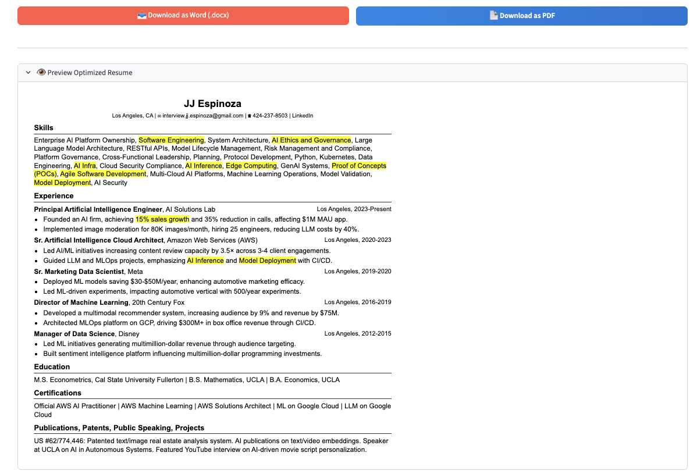
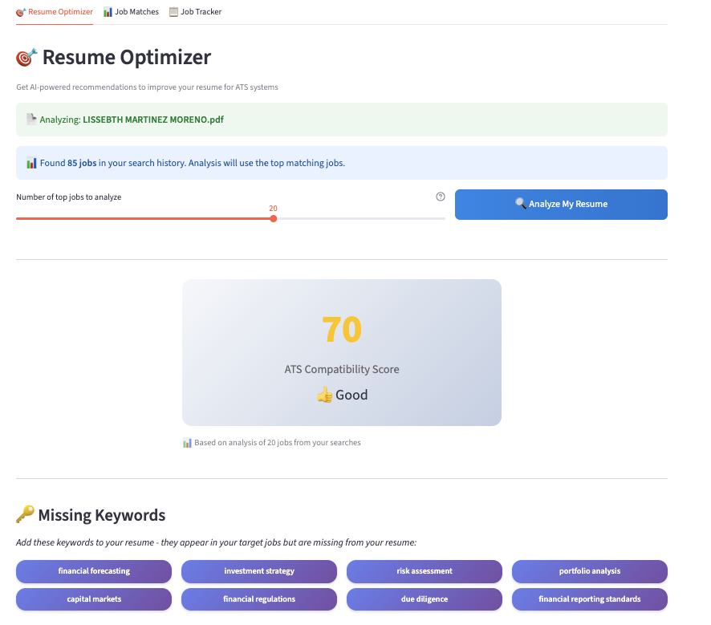
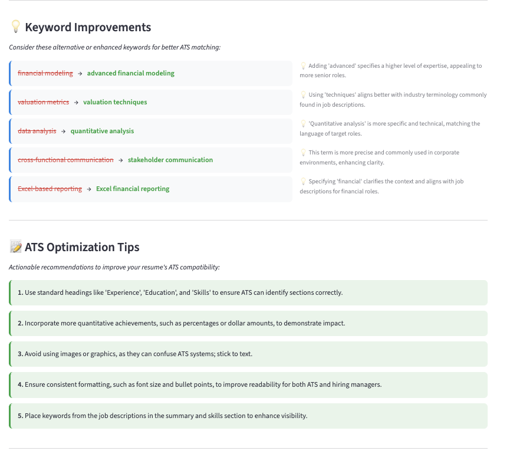
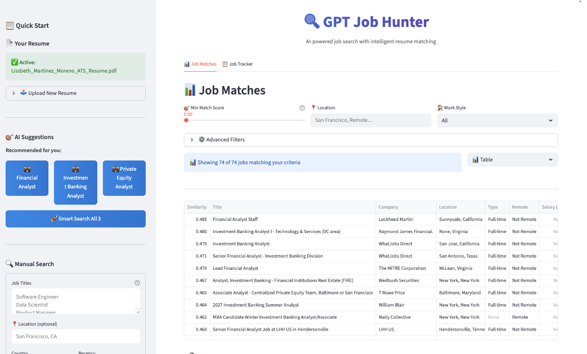
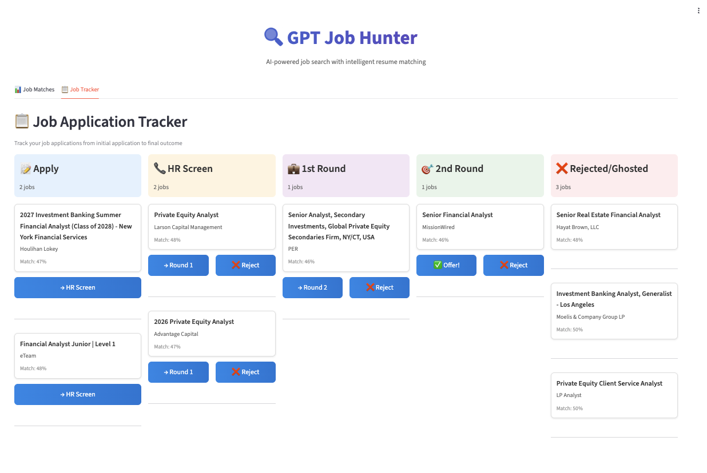

# GPT Job Hunter

An embeddings-based resume/job matching engine with a decoupled FastAPI backend and Streamlit frontend. The core pipeline: extract job postings from an external search API, transform and load them into SQLite, generate OpenAI embeddings for both the resume and every job description, then rank every posting by cosine similarity against the resume. The result is a 0-100% match score, not a keyword-overlap heuristic.

**Why embeddings over keyword matching:** a resume and a job posting rarely share exact phrasing even when the underlying skills line up. Embeddings capture that semantic overlap, so "led a cross-functional engineering team" and "managed engineers across departments" score as similar even with zero shared keywords. That's what makes the 0-100% score a real signal instead of a fuzzy string match.

**Why a decoupled backend/frontend:** the FastAPI backend (port 8000) owns business logic, the embeddings pipeline, and the database; Streamlit (port 8501) is a pure consumer talking to it over REST. Separating them means the matching engine can be tested, deployed, and scaled independently of the UI. The backend has its own API docs, its own test suite, and its own Docker image.

**Relevant to:** full ML product lifecycle (data ingestion → embeddings → serving → CI/CD), retrieval architecture, service decoupling for independent scaling.

[](https://opensource.org/licenses/MIT)
[](https://www.python.org/downloads/)
[](https://fastapi.tiangolo.com)
[](https://streamlit.io)

---

## 🎥 Watch It In Action

See GPT Job Hunter in action! This demo shows the complete workflow from resume upload to job matching:

[](https://youtu.be/4583HitSHdg)

**[▶️ Watch the demo on YouTube](https://youtu.be/4583HitSHdg)**

---

## ✨ What Makes GPT Job Hunter Different?

### ⚡ **Automatic Resume Analysis** - Instant Insights

Upload your resume and GPT Job Hunter **automatically analyzes it** the moment you finish onboarding. Get instant ATS compatibility scores, missing keywords, and optimization tips without lifting a finger. Your analysis is ready before you even search for jobs.

### 🤖 **AI-Powered Resume Rewriting** - Tailor Your Resume to Win

Here's the game-changer: GPT Job Hunter finds your top job matches, then **automatically rewrites your entire resume** to match exactly what those employers want. Your skills and experience stay the same, but the wording, keywords, and focus are perfectly optimized for the positions you're targeting. No more generic resumes—every application gets a custom-tailored version.


*Your resume, rewritten and optimized for the jobs you're going after*

### 🎯 **SmartSearch AI** - Your Personal Job Scout

Our AI instantly generates **personalized job search suggestions** tailored to your background. No more guessing which job titles to search for - GPT Job Hunter knows what you're qualified for.

### 🧠 **Intelligent Resume Matching**

Every job gets an **AI-powered similarity score** (0-100%) showing how well it matches your resume. Focus on the opportunities where you'll actually succeed, not just any job posting.

### 🎨 **ATS Resume Optimizer** - Beat The Bots

Get your resume past Applicant Tracking Systems with AI-powered optimization. Our analyzer provides:
- **ATS Compatibility Score** (0-100) showing how well your resume performs with automated systems
- **Missing Keywords** that appear in target jobs but not in your resume
- **Keyword Improvements** suggesting better alternatives for existing terms
- **Actionable ATS Tips** for formatting, structure, and content optimization

Analyze against your actual job searches or use AI's general knowledge - either way, you'll know exactly what to fix.

### 📊 **Visual Job Application Tracker**

Manage your entire job search pipeline with a beautiful **Kanban-style board**. Track applications from "Apply" → "HR Screen" → "1st Round" → "2nd Round", with a "Rejected/Ghosted" column for the ones that end - all in one place.

---

## 🖼️ Screenshots

### ATS Resume Optimizer - Beat The Bots

*Get an instant ATS compatibility score and see how your resume stacks up against automated screening systems*


*Receive personalized recommendations including missing keywords, keyword improvements, and actionable ATS tips*

### Job Matches - Find Your Perfect Role

*SmartSearch AI suggests relevant job titles, then ranks every opportunity by match score*

### Job Application Tracker - Stay Organized

*Kanban board to track your applications through every interview stage*

---

## 🚀 Key Features

### For Job Seekers

- **⚡ Automatic Resume Analysis** - *NEW* Your resume is analyzed instantly after upload with zero extra clicks
- **🎯 Streamlined Onboarding** - *NEW* Upload resume → Automatic analysis → Results ready in seconds
- **🤖 AI-Powered Resume Rewriting** - *NEW* Automatically rewrites your entire resume tailored to the top jobs you match
- **🤖 AI Job Suggestions** - Get personalized job title recommendations based on your resume
- **📈 Smart Ranking** - Every job scored 0-100% based on resume match quality
- **🎨 ATS Resume Optimizer** - Get AI-powered analysis with compatibility scores, missing keywords, and optimization tips
- **🔑 Keyword Analysis** - Discover what keywords ATS systems are looking for in your target jobs
- **🔍 Advanced Filters** - Filter by location, salary, remote work, job type, and more
- **📋 Application Tracking** - Kanban board to manage your entire job search pipeline
- **📄 Multi-Resume Support** - Store multiple resumes for different roles
- **⚡ Batch Actions** - Open multiple job applications at once
- **💡 Real-time Insights** - Analyze against your actual job searches for targeted recommendations

### Technical Highlights

- **🏗️ Decoupled Architecture** - FastAPI backend + Streamlit frontend for scalability
- **🧬 OpenAI Embeddings** - State-of-the-art text similarity using GPT models
- **📡 RESTful API** - Full API access with OpenAPI/Swagger docs
- **💾 Efficient Storage** - SQLite database with optimized batch operations
- **🐳 Docker Ready** - One-command deployment with Docker Compose
- **🧪 Tested** - Comprehensive test suite included

---

## 🎯 Perfect For

- 📊 **Data Analysts** searching for roles matching their tech stack and optimizing resumes for ATS
- 💼 **Recent Graduates** exploring what jobs fit their degree and learning what keywords employers want
- 🔄 **Career Switchers** finding relevant opportunities and ensuring resumes pass ATS screening
- 🚀 **Professionals** managing multiple job applications efficiently with optimized resumes
- 🎓 **Students** tracking internship opportunities and building ATS-friendly resumes early
- 📝 **Anyone** tired of submitting applications into the void and never hearing back

---

## ⚡ Quick Start

```bash
# 1. Clone the repository
git clone https://github.com/espin086/GPT-Jobhunter.git
cd GPT-Jobhunter

# 2. Set up your API keys
cp .env.example .env
# Edit .env and add:
#   OPENAI_API_KEY=your_key
#   RAPID_API_KEY=your_key
#   JWT_SECRET_KEY=<output of: openssl rand -hex 32>

# 3. Start the application
make dev

# 4. Open your browser
# Frontend: http://localhost:8501
# API Docs: http://localhost:8000/docs
```

**Step by step, with a check at each stage:** [QUICKSTART.md](QUICKSTART.md). Every install option: [INSTALLATION.md](INSTALLATION.md).

`make dev` starts from an empty database on every run. To keep your account and jobs between restarts, see [runbook 01](docs/runbooks/01-local-development.md).

---

## 🎬 How It Works

### 1️⃣ **Upload Your Resume**
Simply drag-and-drop your resume (PDF or TXT) during the quick onboarding. GPT Job Hunter extracts your skills, experience, and qualifications.

### 2️⃣ **Get Instant Analysis** ⚡ *NEW*
The moment you complete onboarding, GPT Job Hunter **automatically analyzes your resume** and redirects you to your results. No extra clicks needed - your ATS compatibility score (0-100), missing keywords, and optimization tips are ready immediately.

### 3️⃣ **Get AI-Powered Suggestions**
Click "SmartSearch AI ✨" and instantly receive job title recommendations that match your background.

### 4️⃣ **Browse Ranked Results**
Every job is scored 0-100% based on how well it matches your resume. Focus on high-scoring opportunities first.

### 5️⃣ **Track Your Applications**
Save promising jobs to your Kanban board and move them through your application pipeline as you progress.

### 6️⃣ **Land Interviews Faster**
Apply to the right jobs with an optimized resume, stay organized, and spend less time searching.

---

## 🔑 API Keys Required

GPT Job Hunter needs two API keys to function:

- **OpenAI API Key** - For AI-powered features ([Get it here](https://platform.openai.com/api-keys))
  - Cost: ~$0.02 per 1,000 jobs analyzed
  - Used for: Resume similarity scoring, SmartSearch suggestions, and ATS optimization analysis

- **RapidAPI Key** - For job search ([Get it here](https://rapidapi.com/letscrape-6bRBa3QguO5/api/jsearch))
  - Free tier: 1,000 searches/month
  - Used for: Fetching job listings from multiple sources

---

## 🛠️ Built With

- **[FastAPI](https://fastapi.tiangolo.com/)** - High-performance Python API framework
- **[Streamlit](https://streamlit.io/)** - Beautiful frontend framework
- **[OpenAI](https://openai.com/)** - GPT-powered embeddings for resume matching
- **[SQLite](https://www.sqlite.org/)** - Lightweight, serverless database
- **[Pandas](https://pandas.pydata.org/)** - Data manipulation and analysis
- **[Poetry](https://python-poetry.org/)** - Modern Python dependency management

---

## 📚 Documentation

| Read this | For |
|---|---|
| [QUICKSTART.md](QUICKSTART.md) | From a fresh clone to ranked jobs in about 15 minutes |
| [INSTALLATION.md](INSTALLATION.md) | Every install option, in detail |
| [docs/architecture/c4.md](docs/architecture/c4.md) | C4 diagrams: context, containers, components, deployment, data model, run sequences, and the known gaps |
| [docs/decisions/](docs/decisions/README.md) | Architecture decision records: why embeddings, why two services, why SQLite, why JSearch, how accounts work, why one container |
| [docs/runbooks/](docs/README.md#runbooks) | Step by step: local development, Docker, keys, search and rate limits, match scores, database backup, accounts |
| [CONTRIBUTING.md](CONTRIBUTING.md) | How to propose and submit a change |
| [API reference](http://localhost:8000/docs) | Interactive, while the backend runs. The same contract is in `openapi.json` |
| [CLAUDE.md](CLAUDE.md) | Short guide for coding agents working in this repository |

---

## 🤝 Contributing

Contributions are welcome. The short version:

1. Find or open the issue your change closes
2. Fork, then branch from `main` with the issue number in the name (`fix/165-rate-limit-backoff`)
3. Make the change with a test
4. Run the tests that need no API keys: `poetry run pytest tests/ --ignore=tests/search_jobs_test.py --ignore=tests/test_embedding.py`
5. Open a pull request whose body contains `Closes #<issue number>`

The full guide, including which docs to update with which change, is [CONTRIBUTING.md](CONTRIBUTING.md).

---

## 📈 Roadmap

### ✅ Recently Completed
- [x] **Automatic Resume Analysis** - Zero-click workflow that analyzes resumes instantly after onboarding
- [x] **Streamlined Onboarding** - Auto-redirect to optimization results with pre-populated insights
- [x] **ATS Resume Optimizer** - AI-powered resume analysis with compatibility scores and keyword suggestions

### 🚀 Coming Soon
- [ ] **Browser Extension** - Apply directly from LinkedIn/Indeed
- [ ] **Email Alerts** - Get notified of new high-match jobs
- [ ] **Cover Letter Generator** - AI-powered cover letters for each application
- [ ] **Interview Prep** - AI-generated interview questions for each job
- [ ] **Salary Insights** - Market data for each position
- [ ] **Multi-User Support** - Team job hunting for bootcamps/universities
- [ ] **Mobile App** - Track applications on the go

---

## 💡 Use Cases

### For Individuals
- **Active Job Seekers** - Apply to 3x more relevant jobs in the same time
- **Passive Candidates** - Keep an eye on opportunities that match your skills
- **Career Explorers** - Discover what roles you're qualified for

### For Organizations
- **Bootcamp Students** - Help graduates find their first tech role
- **University Career Centers** - Support students in their job search
- **Recruiting Agencies** - Match candidates to opportunities faster

---

## 🐛 Known Limitations

- Currently searches US-based job listings only
- Requires paid OpenAI API access for resume matching
- Best results with tech/professional roles
- Job data freshness depends on RapidAPI provider
- Built for one person on one machine. Match scores and dismissed jobs are shared across accounts, and several API routes need no login. Read the [known gaps](docs/architecture/c4.md#known-gaps) before putting it on a shared or public host

---

## 📄 License

This project is licensed under the MIT License - see the [LICENSE](LICENSE.md) file for details.

---

## 🙏 Acknowledgments

- OpenAI for their incredible embedding models
- The Streamlit team for making beautiful UIs easy
- FastAPI for the blazing-fast backend framework
- All the open-source contributors who made this possible

---

## 📞 Support

- **Issues**: [GitHub Issues](https://github.com/espin086/GPT-Jobhunter/issues)
- **Discussions**: [GitHub Discussions](https://github.com/espin086/GPT-Jobhunter/discussions)
- **Something broken?** Start with the "If it fails" table in the matching [runbook](docs/README.md#runbooks)

---

<div align="center">

**⭐ Star this repo if GPT Job Hunter helped you land your dream job! ⭐**

Made with ❤️ by job seekers, for job seekers

[Get Started](QUICKSTART.md) • [Report Bug](https://github.com/espin086/GPT-Jobhunter/issues) • [Request Feature](https://github.com/espin086/GPT-Jobhunter/issues)

</div>
