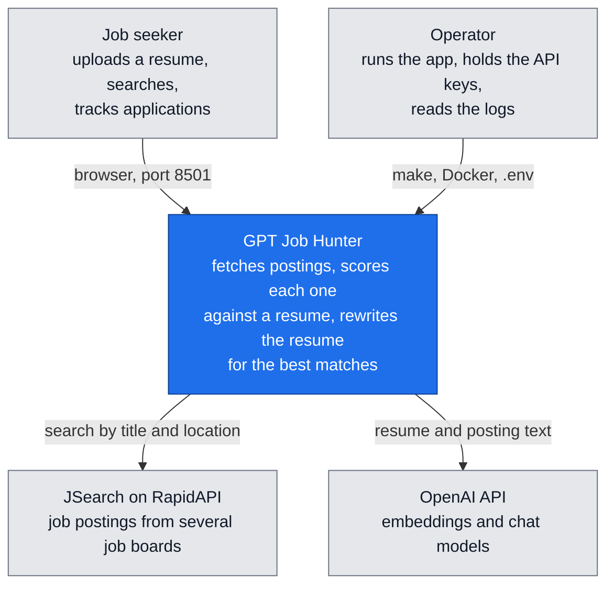
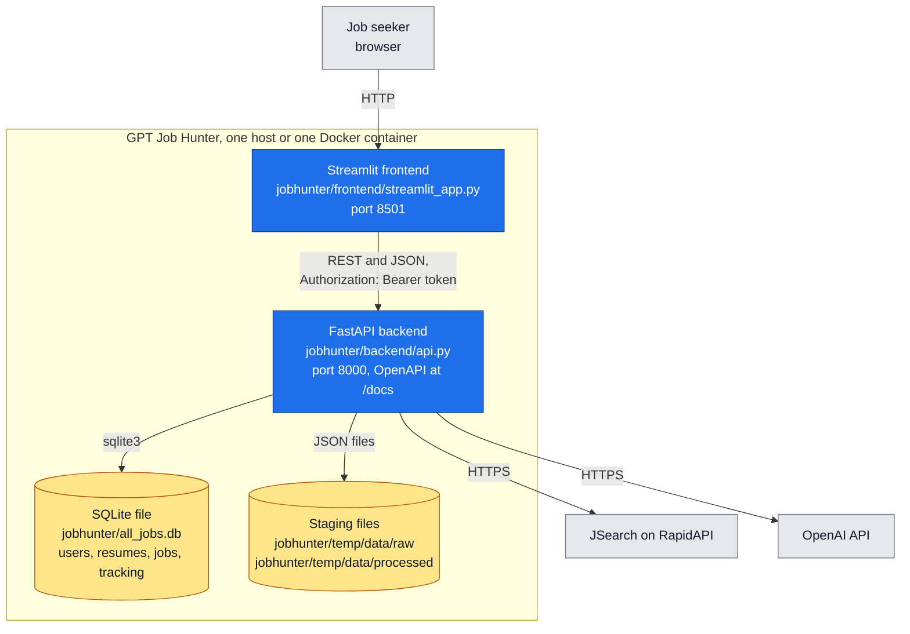
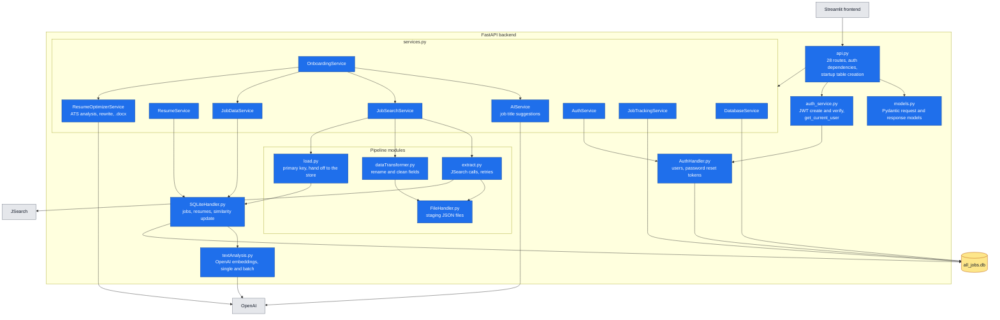
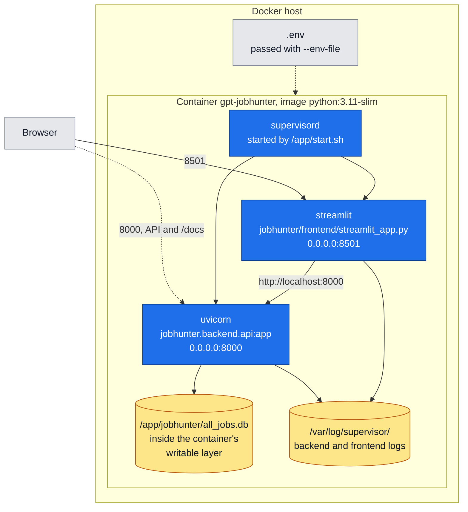
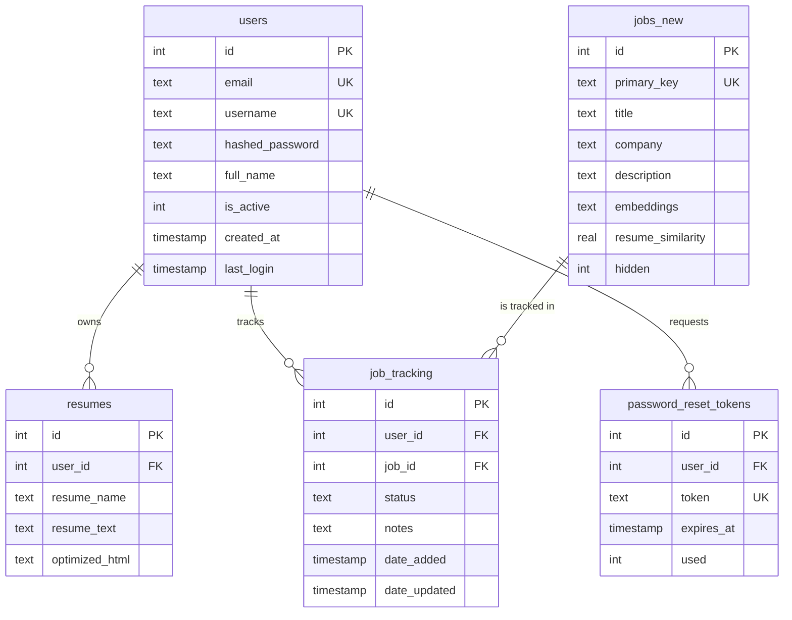
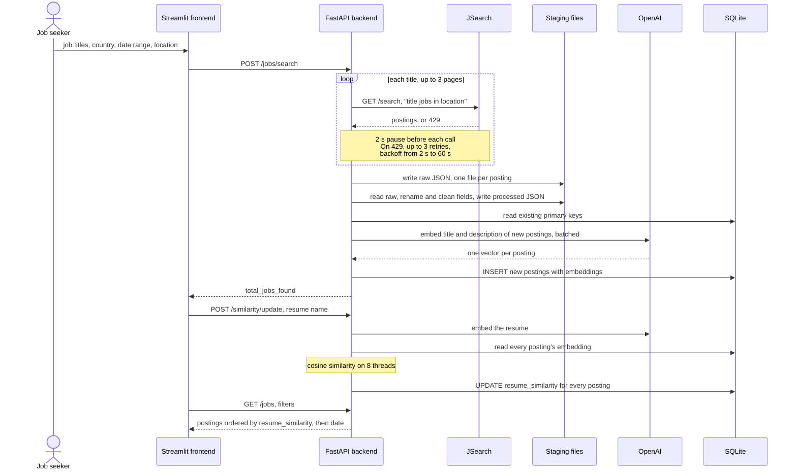
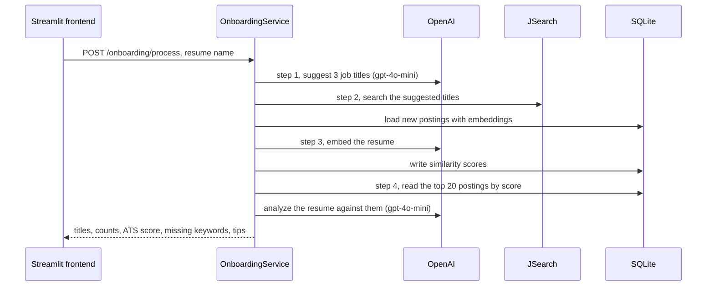
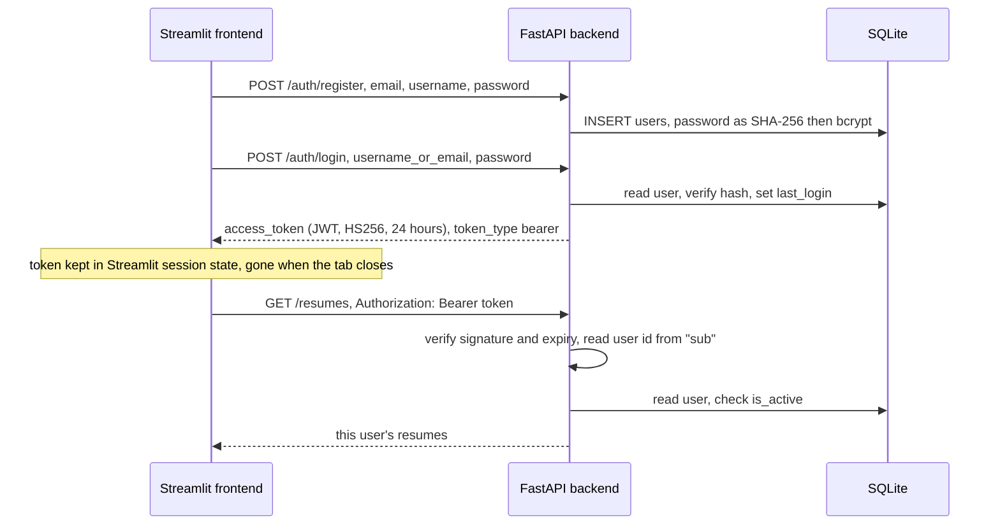

# GPT Job Hunter architecture (C4)

These diagrams show how a resume and a set of job titles become a ranked list of job
postings, and where each piece of that work runs. Read them before changing the pipeline,
the database or the deployment, because the three are tied together by one SQLite file.
They follow the [C4 model](https://c4model.com): context, containers, components, then the
deployment, the data model and three run sequences. The decisions behind each box are in
[docs/decisions/](../decisions/README.md).

Everything here was read from the code at commit `69d202a` and checked against a running
backend on 2026-11-27. Where the code and the README disagree, this page follows the code
and lists the difference under [Known gaps](#known-gaps).

Colors: blue is GPT Job Hunter, grey is outside it, amber is stored data.

## Level 1: system context

Who uses the system and what it depends on.

Two facts follow from this picture. Resume text and posting text leave the machine: both
are sent to OpenAI. And the app cannot find a single job without a RapidAPI key, or score
one without an OpenAI key.

## Level 2: containers

The parts that run as separate processes, and the data they share.

| Container | Owns | Does not do |
|---|---|---|
| Streamlit frontend | Screens, the session's access token, calls to the backend through `BACKEND_URL` | Touch the database or call OpenAI or JSearch |
| FastAPI backend | Accounts, the search pipeline, embeddings, scoring, resume rewriting, the tracker | Render any page |
| SQLite file | Every durable record | Serve more than one writer well (see [ADR 0003](../decisions/0003-sqlite-single-file-with-embeddings-as-json.md)) |
| Staging files | Raw and cleaned postings between pipeline steps | Get cleaned up by the API path (see [Known gaps](#known-gaps)) |

`jobhunter/main.py` is the earlier single-process Streamlit app from before the split on
2025-07-02. `make dev` and the Docker image do not start it. Only
`.devcontainer/devcontainer.json` still does.

## Level 3: components of the backend

| Service | Routes it serves | Outside calls |
|---|---|---|
| `AuthService` | `/auth/register`, `/auth/login`, `/auth/logout`, `/auth/me`, `/auth/password-reset-request`, `/auth/password-reset-confirm` | none |
| `ResumeService` | `/resumes`, `/resumes/upload`, `/resumes/upload-file`, `/resumes/{resume_name}` | none |
| `JobSearchService` | `/jobs/search` | JSearch, OpenAI embeddings |
| `JobDataService` | `/jobs`, `/jobs/count`, `/similarity/update` | OpenAI embeddings |
| `AIService` | `/resumes/suggest-job-titles` | OpenAI `gpt-4o-mini` |
| `ResumeOptimizerService` | `/resumes/optimize`, `/resumes/generate-optimized`, `/resumes/download-word` | OpenAI `gpt-4o-mini` for analysis, `gpt-4o` for the rewrite |
| `JobTrackingService` | `/jobs/save`, `/jobs/pass`, `/jobs/tracked`, `/jobs/tracked/{job_id}/status` | none |
| `OnboardingService` | `/onboarding/process` | everything above |
| `DatabaseService` | `/health`, `/stats`, `/initialize` | none |

The full contract is `openapi.json` in the repository root, regenerated with `make openapi`,
and the live page at `http://localhost:8000/docs`.

## Deployment

One image, one container, two processes.

`make prod` builds the image and starts the container with `--restart unless-stopped`. No
volume is mounted, so the database lives and dies with the container. `make stop`,
`make docker-clean` and a second `make prod` all remove the container.
[Runbook 02](../runbooks/02-deploy-with-docker.md) has the backup step that has to come
first. Local development runs the same two processes directly, with auto-reload; see
[runbook 01](../runbooks/01-local-development.md).

## Data model

`jobs_new` has 20 more descriptive columns (date, salary, location, job type, apply links,
required skills and so on); the diagram keeps the ones the pipeline depends on.

- `jobs_new.primary_key` is the string `"<company> - <title>"`. Two postings with the same
  company and title are one row, and the second is skipped on load.
- `jobs_new.embeddings` is a JSON array of floats stored as text, from OpenAI
  `text-embedding-3-small`.
- `jobs_new.resume_similarity` is cosine similarity between 0.0 and 1.0. The UI shows it as
  a percentage.
- `resumes` is unique on `(user_id, resume_name)` and `job_tracking` on `(user_id, job_id)`.
- `job_tracking.status` is one of `apply`, `hr_screen`, `round_1`, `round_2`, `rejected`.
- Jobs are shared by every account. Resumes and tracking rows belong to one user.
- Tables are created at backend startup by `DatabaseService.initialize_database()` and
  `AuthHandler.create_auth_tables()`. There is no migration tool; new columns are added
  with `ALTER TABLE` inside those functions.

## Run sequence: one job search

Three numbers set the cost and speed of this path:

- **JSearch requests per search** = titles × 3 pages (`PAGES` in `jobhunter/config.py`),
  plus fallback searches with a simpler title when the first returns nothing.
- **Embedding input per posting** is title plus description, cut at 8,000 characters.
- **Scoring is a full scan.** Every posting's vector is read from SQLite and compared in
  Python on each `/similarity/update`.

## Run sequence: onboarding

`POST /onboarding/process` runs four steps for a freshly uploaded resume and reports each
step's result separately, so one failed step does not hide the others.

## Run sequence: sign-in and an authenticated call

`POST /auth/logout` returns success and does nothing on the server. A token stays valid
until it expires. Changing `JWT_SECRET_KEY` signs every user out at once.

## Known gaps

Each of these was observed in the code or on a running backend on 2026-11-27. They are
listed so that a reader does not assume behavior the system lacks. None is fixed by this
page.

| Area | What happens today | Why it matters |
|---|---|---|
| Scores are shared | `resume_similarity` is one column on the shared `jobs_new` table | With two accounts, the last person to score overwrites the ranking everyone sees |
| Passing a job is shared | `/jobs/pass` sets `hidden = 1` on the shared row | A posting one user dismisses disappears for all users |
| Saving a job is shared | `/jobs` leaves out every posting that any user has saved to a tracker | A posting one user saves disappears from every other user's list |
| Rate limits look like empty results | A 429 that survives 3 retries is logged, and the API answers "No jobs found" with HTTP 200 | The user cannot tell a rate limit from a title with no postings; see issue #165 |
| Console command | `pyproject.toml` declares `jobhunter = "jobhunter.cli:main"`, and `cli.py` has no `main` | The installed `jobhunter` command fails with an ImportError; only `python -m jobhunter.cli` works |
| Open routes | `/jobs/search`, `/jobs`, `/jobs/count`, `/stats`, `/initialize` need no token | Anyone who can reach port 8000 can read postings and spend JSearch and OpenAI quota |
| Signing key default | Without `JWT_SECRET_KEY`, tokens are signed with a default string that is in the source | Tokens can be forged; `docker-compose.yml` does not pass the variable |
| Secrets in logs | Token verification logs token fragments, the payload and the first 10 characters of the signing key at INFO. Password reset tokens are logged in full | Anyone with log access can act as a user |
| Password reset | No email is sent; the operator reads the token from the backend log | Reset is an operator task, see [runbook 07](../runbooks/07-accounts-and-password-reset.md) |
| CORS | `allow_origins=["*"]` with credentials | Fine on a laptop, not on a public host |
| No persistent volume | `make prod` keeps the database in the container layer; `make dev` deletes it on every start | Data loss on restart unless backed up first |
| Scoring after search | `JobSearchService` tries to score right after a search but calls `fetch_resumes_from_db()` without a user id; the error is caught and logged as a warning | Scores change only when `/similarity/update` or onboarding runs |
| Staging files pile up | The API path never deletes `temp/data/raw` or `processed` | Each search re-reads every earlier raw file; only `make dev` and the CLI clear them |
| UI library in the backend | `SQLiteHandler.py` and `textAnalysis.py` import Streamlit and call `st.error` | The backend cannot be installed without the frontend's dependency |
| Tracker columns | The code has `apply`, `hr_screen`, `round_1`, `round_2`, `rejected` | The README shows an Offer column that does not exist |
| CI | The workflow uses Python 3.10 and installs from a `requirements.txt` that is not in the repository | The last two runs on `main` failed; see [CONTRIBUTING.md](../../CONTRIBUTING.md) |
